# Examples

The `examples/` folder contains 16 complete problems, numbered by increasing
difficulty. Each one introduces a few new features, and together they cover
most of the RAPTOR interface. All examples use IPOPT, so they run without any
additional installation.

## Running an example

```matlab
cd("path/to/raptor-matlab")
RAPTOR_init();
cd(fullfile("examples", "03-brachistochrone"))
main;
```

Each example folder contains a single `main.m` script. It follows the order
described in the [User Guide](user-guide/index.md): constants, problem and
phases, dynamics, constraints and costs, bounds, initial guess, collocation,
build, settings, solve. The model equations are in the functions passed to
`add`, in the same folder.

Each example shows the automatic plots of RAPTOR. Most examples also create
a few figures of their own, for example in the format of the reference paper
for comparison. To run an example without figures, set `showPlots = false;`
before calling `main`.

When writing your own model functions, see
[Vectorized Functions](getting-started/vectorized-functions.md): the example
functions follow the conventions described there.

## Introductory problems

<div class="rp-cards" markdown>

<div class="rp-card" markdown>
[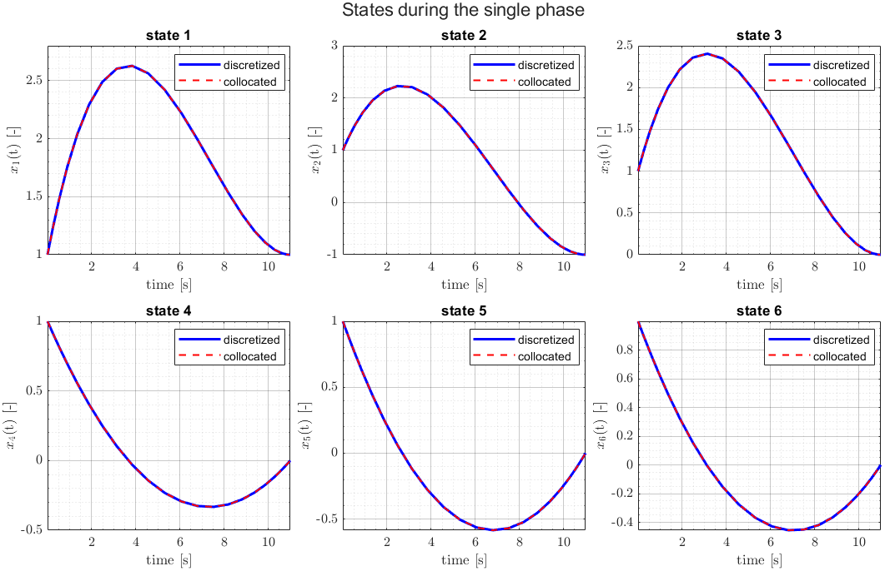{ .rp-card__image loading=lazy }](assets/examples/00-doubleIntegrator.png)

`00-doubleIntegrator` Double integrator
{ .rp-card__title }

Minimum control effort with fixed endpoints and final time. The simplest
complete problem, explained step by step in the
[Quickstart](getting-started/quickstart.md).
</div>

<div class="rp-card" markdown>
[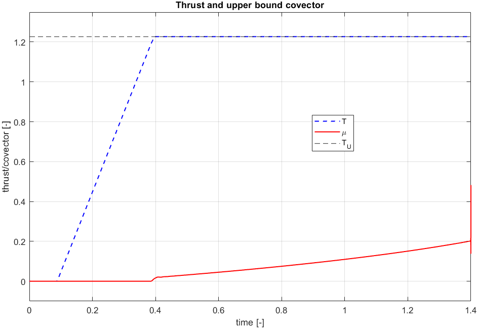{ .rp-card__image loading=lazy }](assets/examples/01-landing1D.png)

`01-landing1D` 1D landing
{ .rp-card__title }

Minimum-fuel vertical landing with free final time and a differential
constraint on the thrust rate. Birkhoff interpolation.
</div>

<div class="rp-card" markdown>
[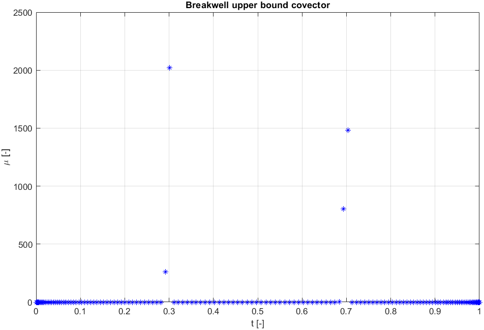{ .rp-card__image loading=lazy }](assets/examples/02-breakwell.png)

`02-breakwell` Breakwell problem
{ .rp-card__title }

Minimum control effort with an upper bound on the position. Plots the
costates and the covector of the bound. Birkhoff interpolation.
</div>

<div class="rp-card" markdown>
[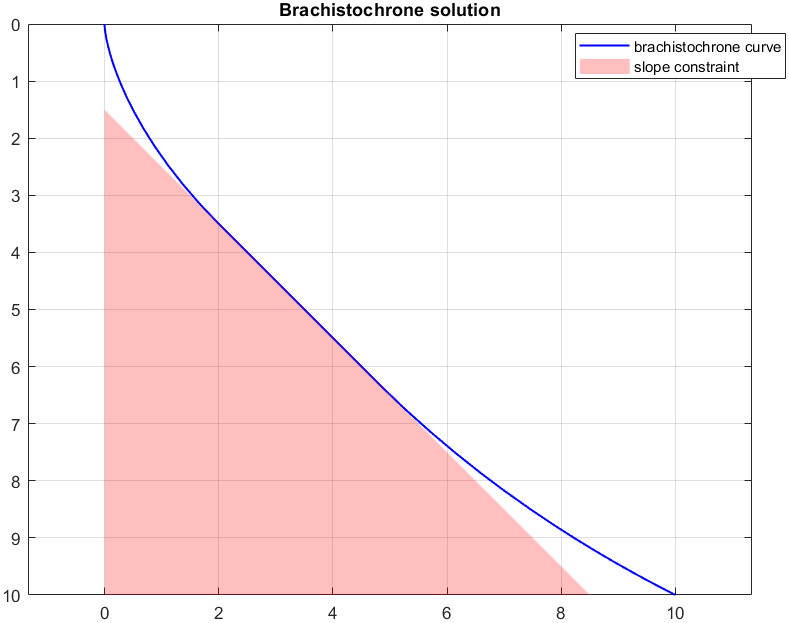{ .rp-card__image loading=lazy }](assets/examples/03-brachistochrone.png)

`03-brachistochrone` Brachistochrone
{ .rp-card__title }

Minimum time with a linear path constraint. Compares the costates with
those obtained by integrating the costate equations.
</div>

<div class="rp-card" markdown>
[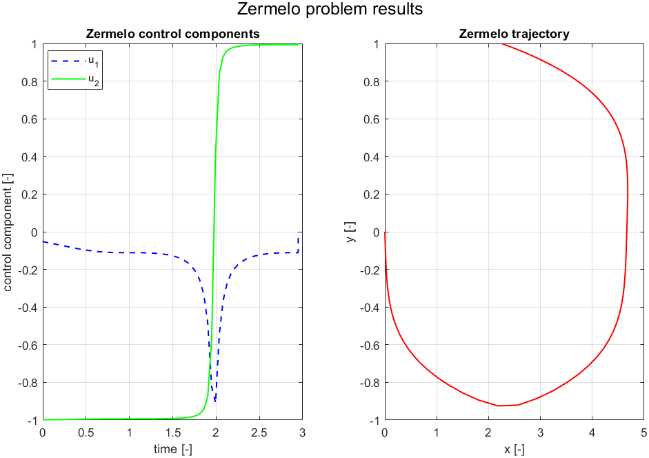{ .rp-card__image loading=lazy }](assets/examples/04-zermelo.png)

`04-zermelo` Zermelo navigation
{ .rp-card__title }

Minimum-time navigation in a current, with the control direction as a
unit vector (nonlinear equality path constraint). Birkhoff interpolation.
</div>

<div class="rp-card" markdown>
[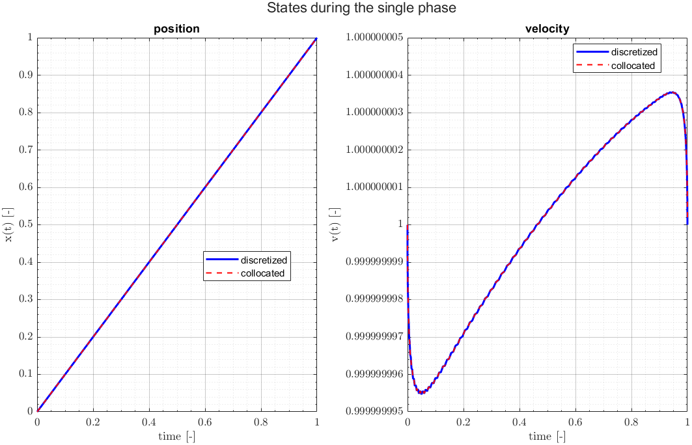{ .rp-card__image loading=lazy }](assets/examples/05-gong.png)

`05-gong` Gong problem
{ .rp-card__title }

Min-max formulation: a local parameter bounds the product of velocity and
control along the trajectory, and is minimized. Birkhoff interpolation.
</div>

</div>

## Classical aerospace problems

<div class="rp-cards" markdown>

<div class="rp-card" markdown>
[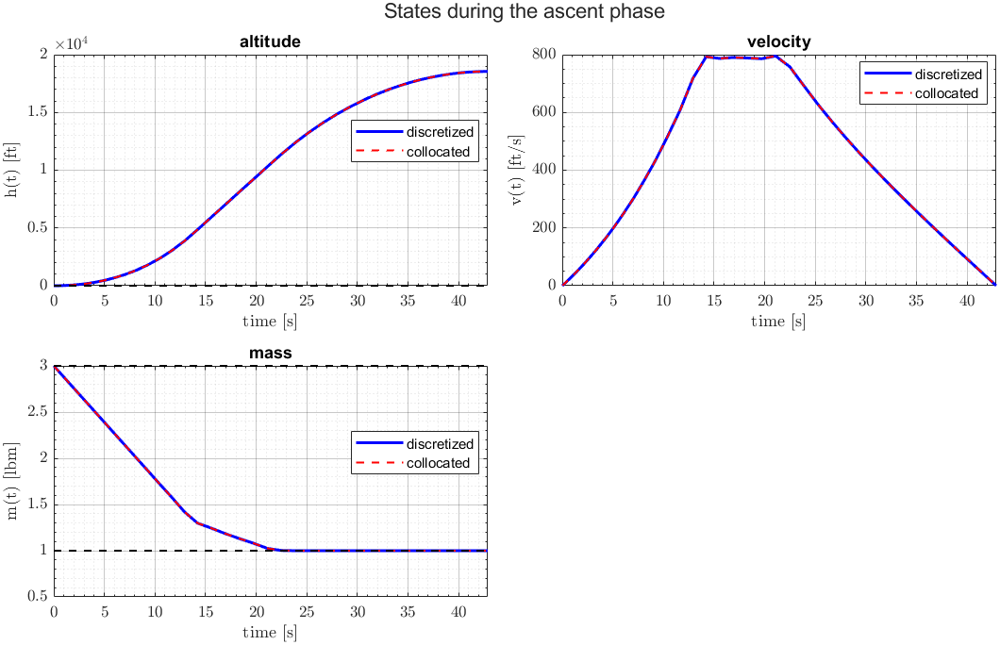{ .rp-card__image loading=lazy }](assets/examples/06-goddardRocket.png)

`06-goddardRocket` Goddard rocket
{ .rp-card__title }

Maximum final altitude of a rocket with drag and free final time.
</div>

<div class="rp-card" markdown>
[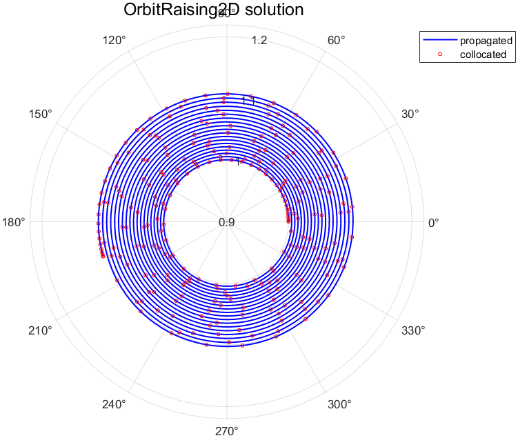{ .rp-card__image loading=lazy }](assets/examples/07-orbitRaising.png)

`07-orbitRaising` Orbit raising
{ .rp-card__title }

Maximum final radius of a low-thrust transfer with fixed duration
(20 revolutions) and a circular final orbit (boundary constraint). Birkhoff
interpolation.
</div>

<div class="rp-card" markdown>
[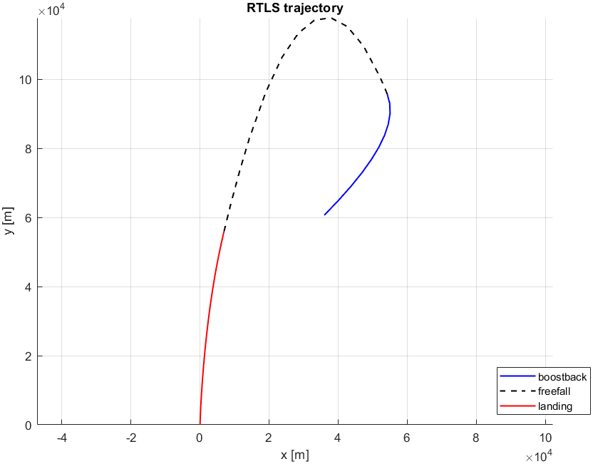{ .rp-card__image loading=lazy }](assets/examples/08-rlvReturn.png)

`08-rlvReturn` RLV return to launch site
{ .rp-card__title }

Maximum final mass over three phases (boostback, free fall, landing)
joined by continuity, plotted as a single trajectory.
</div>

</div>

## Vehicle problems

<div class="rp-cards" markdown>

<div class="rp-card" markdown>
[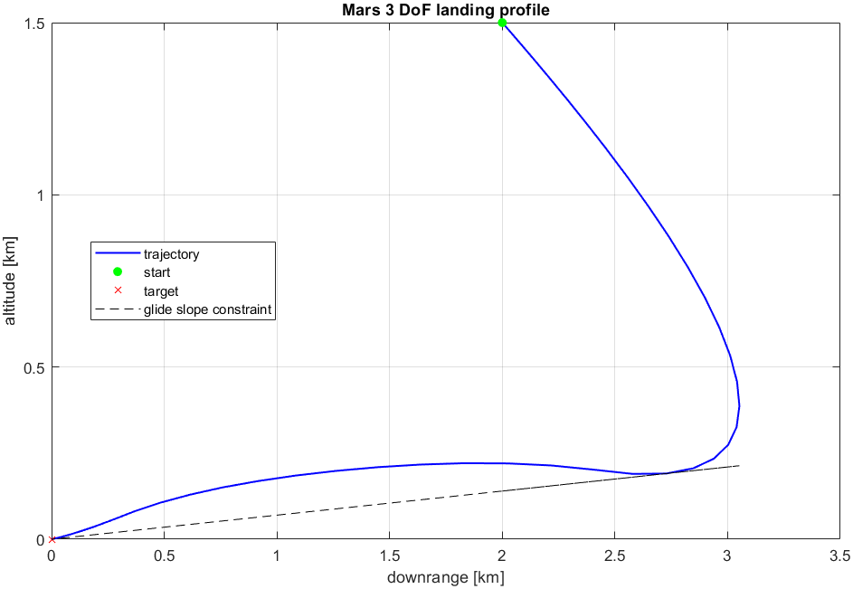{ .rp-card__image loading=lazy }](assets/examples/09-marsLanding3DoF.png)

`09-marsLanding3DoF` Mars powered landing (3-DoF)
{ .rp-card__title }

Minimum-fuel landing with thrust bounds and a glide-slope constraint,
compared with the reference paper.
</div>

<div class="rp-card" markdown>
[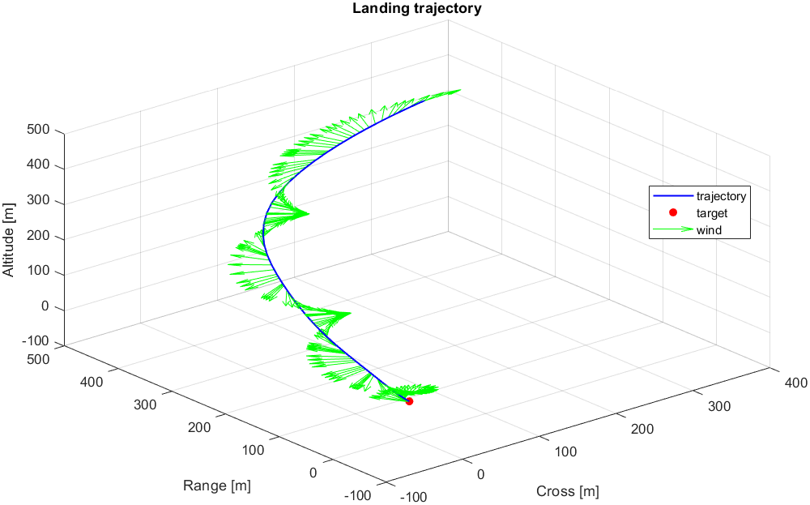{ .rp-card__image loading=lazy }](assets/examples/10-windyLanding3DoF.png)

`10-windyLanding3DoF` Landing with wind (3-DoF)
{ .rp-card__title }

Minimum-fuel landing with a time-dependent wind, passed to the dynamics as
a function handle in `auxdata`.
</div>

<div class="rp-card" markdown>
[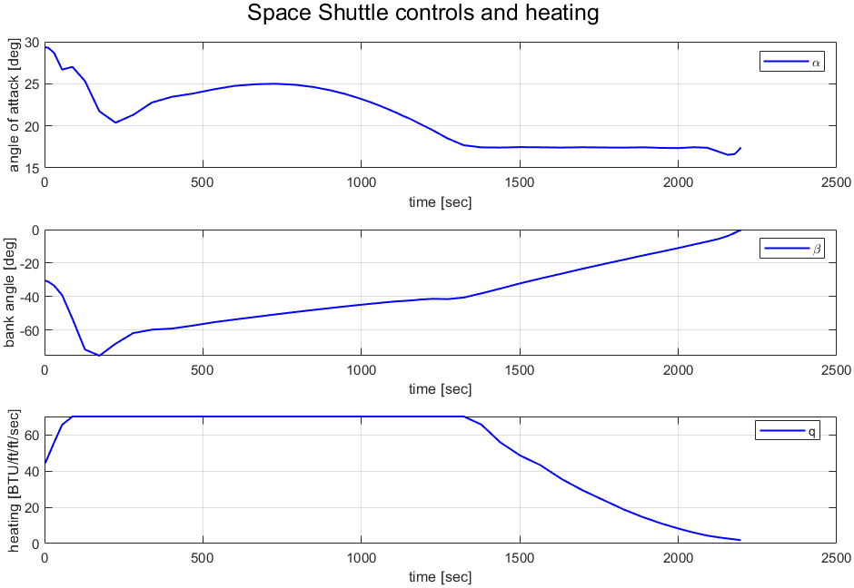{ .rp-card__image loading=lazy }](assets/examples/11-shuttleReentry.png)

`11-shuttleReentry` Space shuttle reentry
{ .rp-card__title }

Maximum crossrange with a heating limit, on an hp grid.
</div>

<div class="rp-card" markdown>
[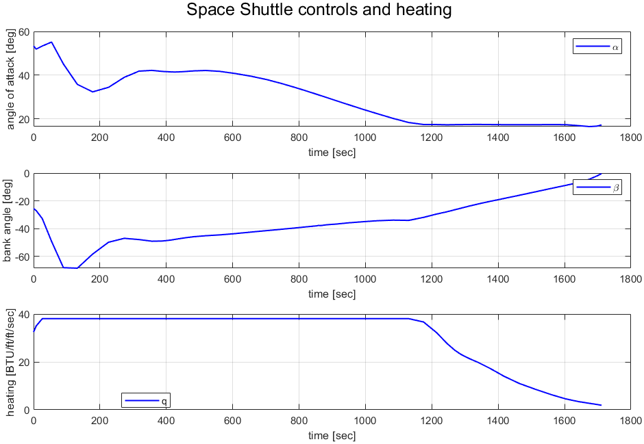{ .rp-card__image loading=lazy }](assets/examples/12-shuttleReentryMinHeating.png)

`12-shuttleReentryMinHeating` Shuttle reentry, minimum heating
{ .rp-card__title }

Minimum peak heating (min-max with a local parameter), with fixed final
latitude and limits on the rates of the flight path and heading angles, on
an hp grid.
</div>

<div class="rp-card" markdown>
[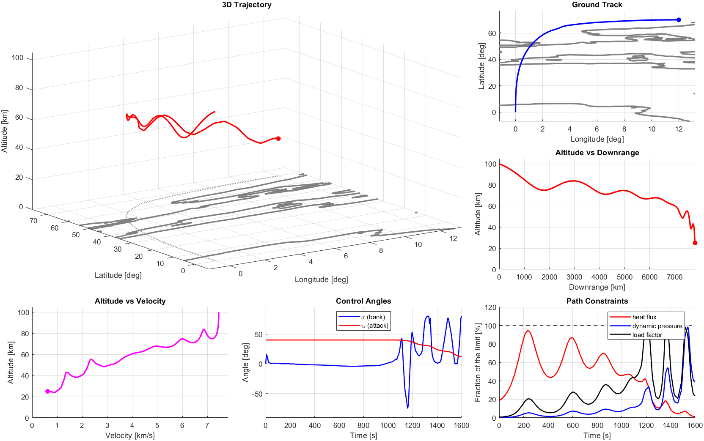{ .rp-card__image loading=lazy }](assets/examples/13-hypersonicEntry.png)

`13-hypersonicEntry` Hypersonic entry
{ .rp-card__title }

Minimum final velocity at a fixed final time, with Earth rotation, the
bank angle rate as control, and heat flux, dynamic pressure and load limits,
on an hp grid.
</div>

<div class="rp-card" markdown>
[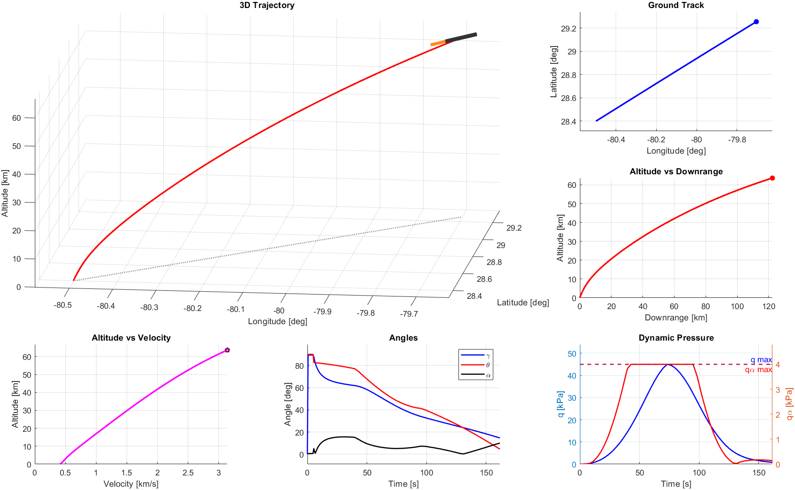{ .rp-card__image loading=lazy }](assets/examples/14-rocketAscent.png)

`14-rocketAscent` Rocket ascent (3-DoF)
{ .rp-card__title }

Minimum-time first-stage ascent to separation conditions and orbit
inclination, with the US76 atmosphere, J2 gravity and dynamic pressure
limits. Includes an animated dashboard of the ascent.
</div>

<div class="rp-card" markdown>
[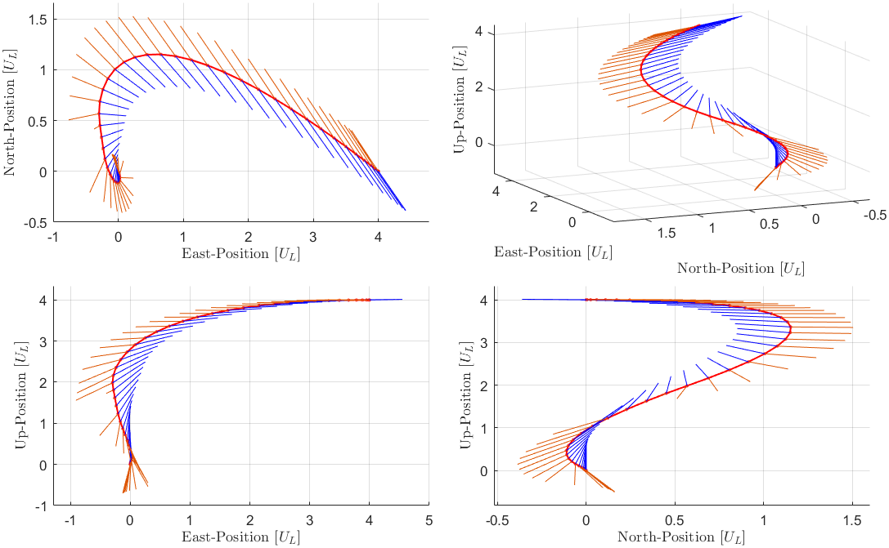{ .rp-card__image loading=lazy }](assets/examples/15-marsLanding6DoF.png)

`15-marsLanding6DoF` Mars powered landing (6-DoF)
{ .rp-card__title }

Minimum-time landing with quaternion attitude dynamics, thrust, glide
slope, tilt, angular rate and gimbal constraints, compared with the reference
paper.
</div>

</div>

## Starting your own problem

Copy the most similar example into a new folder and change it in this order:
names and variable ordering, dynamics (test them separately), bounds and
boundary conditions, constraints and costs, initial guess, and finally the
grid and solver settings. Review the tolerances, scaling and number of nodes
for the new problem instead of copying them unchanged.

Alternatively, run `createMainTemplate()` in an empty folder to create a
template `main.m` for a single-phase problem.

!!! warning
    `createMainTemplate()` overwrites any existing `main.m` in the current
    folder.
