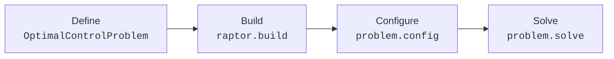

# Core Concepts

This page describes the problem formulation used by RAPTOR and the
conventions that all user functions follow.

## Problem formulation

For a single phase, RAPTOR solves problems of the form

\[
\begin{aligned}
\min \quad & \Phi\big(t_0, x(t_0), t_f, x(t_f)\big) + \int_{t_0}^{t_f} L\big(t, x(t), u(t)\big)\, \mathrm{d}t \\
\text{subject to} \quad & \dot{x}(t) = f\big(t, x(t), u(t)\big) \\
& g_{\min} \le g\big(t, x(t), u(t)\big) \le g_{\max} \\
& \psi_{\min} \le \psi\big(t_0, x(t_0), t_f, x(t_f)\big) \le \psi_{\max}
\end{aligned}
\]

with lower and upper bounds on \(t_0\), \(t_f\), \(x\) and \(u\). Each term
corresponds to a property of a phase:

| Term | Meaning | RAPTOR property |
| --- | --- | --- |
| \(\Phi\) | endpoint (Mayer) cost | `phase.costs.mayer` |
| \(L\) | running (Lagrange) cost | `phase.costs.lagrange` |
| \(f\) | dynamics | `phase.dynamics` |
| \(g\) | path constraints | `phase.constraints.path` |
| \(\psi\) | boundary constraints | `phase.constraints.boundary` |
| bounds | simple bounds on the variables | `phase.box`, `phase.boundaryConditions` |

A problem can have several phases. Phases are connected by linkage
constraints between the end of one phase and the start of the next. All
functions can also depend on static parameters, either specific to one phase
(local) or shared by all phases (global).

## Workflow



1. **Define** the problem with `raptor.api.v1.OptimalControlProblem` and its
   phases.
2. **Build** it with `raptor.build(ocp)`. RAPTOR checks the dimensions,
   evaluates the functions on the initial guess, detects the sparsity of the
   derivatives, and returns a solver object.
3. **Configure** the numerical settings in `problem.config`.
4. **Solve** with `problem.solve()`.

!!! note "Rebuild after changing the problem"
    Changes made to `ocp` after `raptor.build` do not affect the built
    `problem`. Call `raptor.build` again after changing the problem
    definition. Changes to `problem.config` do not require a rebuild.

## Phases

A phase is a time interval with a fixed number of states, controls and local
parameters. Use more than one phase when something changes at a known event,
for example the dynamics, the number of variables, the active constraints or
the coordinates.

Phase names must be valid MATLAB identifiers, because they are used as field
names in the solution (`sol.ascent`, `sol.coast`, ...).

## Variables and data

| Quantity | Time-varying | Scope | Field in `inputData` |
| --- | :---: | --- | --- |
| Time | yes | phase | `time` |
| States | yes | phase | `states` |
| Controls | yes | phase | `controls` |
| Local parameters | no | one phase | `localParameters` |
| Global parameters | no | all phases | `globalParameters` |
| Auxiliary data | no, not optimized | problem | `auxdata` |

Quantities that the optimizer can change must be states, controls or
parameters. `auxdata` contains constants and data used by the functions;
RAPTOR does not optimize it or differentiate with respect to it.

## Array sizes

Time-varying quantities have **one row per component and one column per time
instant**. For `nx` states, `nu` controls and `N` time instants:

| | Size |
| --- | --- |
| `inputData.time` | `1 x N` |
| `inputData.states` | `nx x N` |
| `inputData.controls` | `nu x N` |
| dynamics output | `nx x N` |
| path constraint output with `ng` components | `ng x N` |
| running cost output | `1 x N` |

RAPTOR calls the functions both at single points and at many points at once.
Use element-wise operators and explicit dimensions so that the code works for
any `N`:

```matlab
speed = sqrt(sum(inputData.states(4:6, :).^2, 1));   % 1-by-N
```

!!! tip "Writing vectorized functions"
    [Vectorized Functions](vectorized-functions.md) shows how to write products, norms, dot
    and cross products, matrix products, conditions and tables in this form,
    with a complete example and a way to test your functions.

## Path and boundary functions

=== "Path functions"

    Dynamics, running costs, path constraints and differential constraints
    are evaluated along the trajectory. Available fields:

    ```text
    time   states   controls   localParameters   globalParameters   auxdata
    ```

=== "Boundary functions"

    Endpoint costs, boundary constraints and linkages are evaluated at the
    endpoints of the phase. Available fields:

    ```text
    initialTime     finalTime
    initialStates   finalStates
    initialControls finalControls
    localParameters globalParameters auxdata
    upstreamParameters   (linkages only)
    ```

All functions take exactly one input, `inputData`, and return a numeric
array.

## Checking a solution

| Check | Meaning | Where to look |
| --- | --- | --- |
| **Build** | The problem definition passed RAPTOR's checks. | `raptor.build` returns without error |
| **Solve** | The NLP solver reports success. | `sol.exitStatus`, solver output |
| **Validation** | Integrating the dynamics with the optimal controls reproduces the solution. | `sol.<phase>.propagated.errors` |

Accept a solution only when all three checks pass and the result is
physically reasonable.
